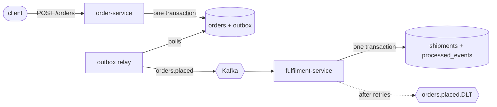

# order-events

[](https://github.com/nagarjuna-thumma/order-events/actions/workflows/build.yml)

Two small Spring Boot services that talk through Kafka. The order service takes orders and the fulfilment service creates a shipment for each one.

The business logic is deliberately thin. I built this to show the parts of event-driven systems that usually go wrong in production: losing events when the broker is down, processing the same message twice, and one bad message blocking a whole partition.



## What's in it

**Transactional outbox (order-service).** Placing an order writes the order and its event to Postgres in one transaction. A scheduled relay then sends unpublished events to Kafka and marks them sent. If Kafka is down, orders are still accepted and the events go out once it's back. The relay uses `FOR UPDATE SKIP LOCKED`, so you can run more than one instance without double-sending.

**Idempotent consumer (fulfilment-service).** The outbox gives at-least-once delivery, so duplicates are expected. Each handled event id is stored in `processed_events` in the same transaction as the shipment, and repeats are skipped. The primary key on that table is the real guard. The `existsById` check just avoids a pointless insert.

**Retries and a dead-letter topic.** Failed messages are retried with exponential backoff, then moved to `orders.placed.DLT`. Messages that can't be parsed go straight to the DLT, because retrying won't fix them.

**Ordering.** Events are keyed by order id, so everything about one order stays on one partition and in order. The relay stops at the first failed send in a batch for the same reason.

## Monitoring

Both services expose Prometheus metrics at `/actuator/prometheus`. The ones that matter for this design:

| Metric | What it tells you |
|---|---|
| `outbox_pending` | Events saved with an order but not yet sent to Kafka |
| `outbox_oldest_age_seconds` | How long the oldest of those has been waiting. This is the real lag number. |
| `outbox_publish_failures_total` | Failed sends from the relay |
| `orders_placed_duplicates_total` | Redeliveries the idempotent consumer skipped |
| `orders_placed_dead_lettered_total` | Events that failed every retry and went to the DLT |

`docker compose up -d` also starts Prometheus (port 9090) with alert rules in [`monitoring/alerts.yml`](monitoring/alerts.yml) and Grafana (port 3000) with the dashboard below already loaded.


The screenshot is from a test where I stopped Kafka for about three minutes. Orders kept coming back `201 Created`, the backlog and its age climbed, and `OutboxBacklogGrowing` went to pending. When Kafka came back the relay drained all 25 events in one pass. The consumer skipped 3 redeliveries, and the one message I sent that wasn't JSON ended up on the DLT.

Alerts:

- **OutboxBacklogGrowing** fires when the oldest unsent event is over 60 seconds old for 2 minutes. Age catches a stuck relay even when traffic is low, which a plain backlog count would miss.
- **OutboxPublishFailures** fires when sends keep failing for 5 minutes.
- **MessagesDeadLettered** fires on any new DLT message, because each one needs someone to look at it.
- **ServiceDown** fires when a scrape fails for a minute.

## Running it

You need Java 21 and Docker.

```bash
docker compose up -d                      # Postgres, Kafka, Prometheus, Grafana
mvn -pl order-service spring-boot:run      # port 8080
mvn -pl fulfilment-service spring-boot:run # port 8081, in another terminal
```

Place an order, then look up its shipment:

```bash
curl -s -X POST localhost:8080/orders \
  -H 'Content-Type: application/json' \
  -d '{"customerId":"cust-1","sku":"BOOK-123","quantity":2,"totalAmount":39.98}'

curl -s localhost:8081/shipments/<order id from the response>
```

## Tests

```bash
mvn verify
```

Unit tests use JUnit 5 and Mockito. The integration tests start real Postgres and Kafka with Testcontainers, so they need Docker. They check that:

- an order placed over HTTP ends up as a message on `orders.placed`
- the same event delivered twice creates only one shipment
- an unreadable message lands on the dead-letter topic

GitHub Actions runs the full suite on every push.

## Stack

Java 21 · Spring Boot 3.5 · Spring Kafka · Spring Data JPA · PostgreSQL · Flyway · Micrometer · Prometheus · Grafana · Testcontainers · Docker Compose · GitHub Actions

## What I'd add next

- Avro or JSON Schema with a schema registry instead of each service keeping its own copy of the event
- A cleanup job for old published outbox rows and old `processed_events` rows
- Debezium CDC as an alternative to the polling relay
