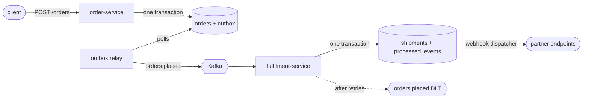
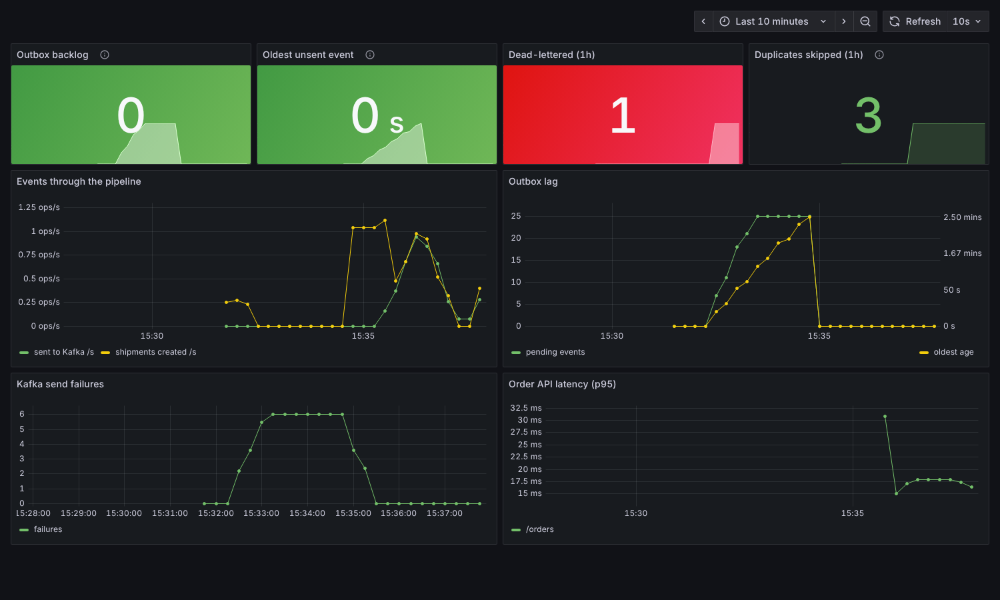

# order-events

[](https://github.com/nagarjuna-thumma/order-events/actions/workflows/build.yml)

Two small Spring Boot services that talk through Kafka. The order service takes orders and the fulfilment service creates a shipment for each one.

The business logic is deliberately thin. I built this to show the parts of event-driven systems that usually go wrong in production: losing events when the broker is down, processing the same message twice, and one bad message blocking a whole partition.



## What's in it

**Transactional outbox (order-service).** Placing an order writes the order and its event to Postgres in one transaction. A scheduled relay then sends unpublished events to Kafka and marks them sent. If Kafka is down, orders are still accepted and the events go out once it's back. The relay uses `FOR UPDATE SKIP LOCKED`, so you can run more than one instance without double-sending.

**Idempotent consumer (fulfilment-service).** The outbox gives at-least-once delivery, so duplicates are expected. Each handled event id is stored in `processed_events` in the same transaction as the shipment, and repeats are skipped. The primary key on that table is the real guard. The `existsById` check just avoids a pointless insert.

**Retries and a dead-letter topic.** Failed messages are retried with exponential backoff, then moved to `orders.placed.DLT`. Messages that can't be parsed go straight to the DLT, because retrying won't fix them.

**Ordering.** Events are keyed by order id, so everything about one order stays on one partition and in order. The relay stops at the first failed send in a batch for the same reason.

## Webhooks

The fulfilment service tells outside systems (a warehouse, a customer's own app) about new shipments by POSTing `shipment.created` events to URLs they register. Getting this right is the same problem as the Kafka side, just over HTTP to servers you don't control.

```bash
curl -s -X POST localhost:8081/webhooks/subscriptions \
  -H 'Content-Type: application/json' -d '{"url":"https://partner.example/hooks"}'
# {"id":"...","url":"...","secret":"whsec_...","createdAt":"..."}   the secret is only shown here
```

**Saved with the shipment.** Creating a shipment writes one `webhook_deliveries` row per active subscriber in the same transaction. A webhook is never sent for a shipment that rolled back and never lost for one that committed. It's the outbox pattern again.

**Signed.** Each request carries `X-Webhook-Signature: t=<unix time>,v1=<HMAC-SHA256 of "t.body">`. The timestamp is inside the signature, so a receiver can reject anything older than a few minutes and a captured request can't be replayed. `WebhookSignature.verify` is the receiver side and compares in constant time.

**Same id on every retry.** `X-Webhook-Id` stays the same across attempts so the receiver can drop duplicates, like the idempotent consumer does here.

**Retries that don't make things worse.** 5xx, 408, 429, timeouts and connection errors are retried with exponential backoff (10 s doubling to a 1 h cap, 12 attempts, about 3.5 hours) with jitter, so a partner coming back from an outage isn't hit by every queued event in the same second. Other 4xx answers mean the request itself is wrong, so the delivery fails at once.

**No locks held during the HTTP call.** The dispatcher claims due rows with `FOR UPDATE SKIP LOCKED` and leases them for 60 s in one short transaction, sends outside any transaction, then records the result in another. Several instances can run the dispatcher, and a slow partner doesn't tie up database connections.

**Operator tools.** `GET /webhooks/deliveries?status=FAILED` lists what gave up, `POST /webhooks/deliveries/{id}/redeliver` replays one once the partner is fixed, and `webhook_deliveries_total{outcome=delivered|retry|failed}` goes to Prometheus.

## Monitoring

Both services expose Prometheus metrics at `/actuator/prometheus`. The ones that matter for this design:

| Metric | What it tells you |
|---|---|
| `outbox_pending` | Events saved with an order but not yet sent to Kafka |
| `outbox_oldest_age_seconds` | How long the oldest of those has been waiting. This is the real lag number. |
| `outbox_publish_failures_total` | Failed sends from the relay |
| `orders_placed_duplicates_total` | Redeliveries the idempotent consumer skipped |
| `orders_placed_dead_lettered_total` | Events that failed every retry and went to the DLT |

`docker compose up -d` also starts Prometheus (port 9090) with alert rules in [`monitoring/alerts.yml`](monitoring/alerts.yml) and Grafana (port 3000) with the dashboard below already loaded.



The screenshot is from a test where I stopped Kafka for about three minutes. Orders kept coming back `201 Created`, the backlog and its age climbed, and `OutboxBacklogGrowing` went to pending. When Kafka came back the relay drained all 25 events in one pass. The consumer skipped 3 redeliveries, and the one message I sent that wasn't JSON ended up on the DLT.

Alerts:

- **OutboxBacklogGrowing** fires when the oldest unsent event is over 60 seconds old for 2 minutes. Age catches a stuck relay even when traffic is low, which a plain backlog count would miss.
- **OutboxPublishFailures** fires when sends keep failing for 5 minutes.
- **MessagesDeadLettered** fires on any new DLT message, because each one needs someone to look at it.
- **ServiceDown** fires when a scrape fails for a minute.

## Tracing and logs

Both services use Micrometer Tracing with the OpenTelemetry bridge and send spans over OTLP to Jaeger (http://localhost:16686 when compose is up). One order is one trace, from the HTTP request to the partner's webhook:

```
POST /orders                         order-service
  outbox publish                     order-service, scheduled relay
    orders.placed send               Kafka producer
      orders.placed receive          fulfilment-service consumer
        webhook deliver              fulfilment-service, scheduled dispatcher
          http post                  call to the partner, with a traceparent header
```

The hard part is the two pollers. The outbox relay and the webhook dispatcher run later on their own threads, so the normal in-process propagation has nothing to carry. Each row stores the W3C `traceparent` of the span that created it (`outbox_events.trace_parent`, `webhook_deliveries.trace_parent`), and the poller starts its span as a child of that. Kafka observation is switched on for the producer and the listener, so the header crosses the broker on its own.

`TracingIntegrationTest` sends a request with a known trace id and checks the same id comes out on the Kafka message after the relay. A webhook test does the same from a Kafka header to the HTTP request the partner receives.

Every log line carries `traceId` and `spanId`, so you can go from a log to the trace and back. In Kubernetes the services log one JSON object per line in Elastic Common Schema (`LOGGING_STRUCTURED_FORMAT_CONSOLE=ecs`), ready for Fluent Bit or a similar shipper. Locally they log plain text.

## Running it

You need Java 21 and Docker.

```bash
docker compose up -d                      # Postgres, Kafka, Jaeger, Prometheus, Grafana
mvn -pl order-service spring-boot:run      # port 8080
mvn -pl fulfilment-service spring-boot:run # port 8081, in another terminal
```

Place an order, then look up its shipment:

```bash
curl -s -X POST localhost:8080/orders \
  -H 'Content-Type: application/json' \
  -d '{"customerId":"cust-1","sku":"BOOK-123","quantity":2,"totalAmount":39.98}'

curl -s localhost:8081/shipments/<order id from the response>
```

## Kubernetes

[`k8s/`](k8s) has Kustomize manifests for the whole stack: both services, plus a single-node Postgres and Kafka so it runs on a laptop cluster.

```bash
mvn -DskipTests package
docker build --build-arg SERVICE=order-service -t order-service:latest .
docker build --build-arg SERVICE=fulfilment-service -t fulfilment-service:latest .
kind load docker-image order-service:latest fulfilment-service:latest
kubectl apply -k k8s
```

Things in the manifests that are there for a reason:

- **Two replicas of each service.** The outbox relay locks rows with `SKIP LOCKED`, so two order-service pods can poll the same table without sending an event twice. The two fulfilment pods share a consumer group and split the topic's three partitions.
- **Separate startup, liveness and readiness probes** on Spring Boot's health groups. A slow start doesn't get the pod killed, and a pod only gets traffic once its database connection is up.
- **Graceful shutdown.** A short `preStop` pause lets the Service stop routing to the pod, then Spring finishes in-flight requests before the JVM exits. Rolling updates use `maxUnavailable: 0`, and a PodDisruptionBudget keeps one pod of each service up during node drains.
- **Locked-down containers.** They run as a non-root user with a read-only root filesystem and no Linux capabilities.
- **Layered image.** Dependencies sit in their own Docker layer, so a code change only rebuilds the small application layer.

CI deploys all of this to a [kind](https://kind.sigs.k8s.io) cluster on every push and runs [`k8s/smoke-test.sh`](k8s/smoke-test.sh). The script places an order through the order-service and waits for the fulfilment-service to create the shipment.

## Google Cloud

[`infra/gcp`](infra/gcp) has Terraform for running both services on Cloud Run with Cloud SQL Postgres on a private IP, the database password in Secret Manager, a service account per service and an Artifact Registry repository. Cloud Run keeps CPU allocated and one instance warm, because the outbox relay, the consumer and the webhook dispatcher work in the background. `terraform test` checks the important settings against mocked providers in CI. Details in [infra/gcp/README.md](infra/gcp/README.md).

## Tests

```bash
mvn verify
```

Unit tests use JUnit 5 and Mockito. The integration tests start real Postgres and Kafka with Testcontainers, so they need Docker. They check that:

- an order placed over HTTP ends up as a message on `orders.placed`
- the same event delivered twice creates only one shipment
- an unreadable message lands on the dead-letter topic
- a webhook receiver that returns 500 twice gets the event on the third try, with the same id each time and a signature that verifies
- a 400 is not retried, shows up as FAILED and can be redelivered by hand
- a receiver that never recovers stops getting requests after the last attempt
- the trace id from an incoming request reaches the Kafka message after the outbox relay, and the trace id on a Kafka message reaches the partner's webhook request

The webhook tests run a real HTTP server inside the test as the partner endpoint. `WebhookSignatureTest` checks the HMAC against one computed with `openssl`.

GitHub Actions runs the full suite on every push, then deploys to kind and runs the smoke test.

## Stack

Java 21 · Spring Boot 3.5 · Spring Kafka · Spring Data JPA · PostgreSQL · Flyway · Micrometer · OpenTelemetry · Jaeger · Prometheus · Grafana · Testcontainers · Docker · Kubernetes · Terraform · Google Cloud Run · Cloud SQL · Docker Compose · GitHub Actions

## What I'd add next

- Avro or JSON Schema with a schema registry instead of each service keeping its own copy of the event
- A cleanup job for old published outbox rows and old `processed_events` rows
- Debezium CDC as an alternative to the polling relay
- Encrypt webhook secrets at rest and support rotating them with two valid secrets for a while
- Turn off a webhook subscription automatically after it has failed for days
