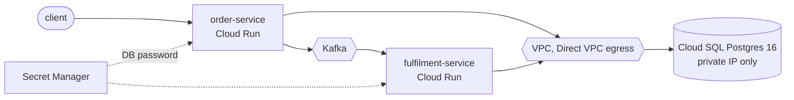

# Deploying to Google Cloud

Terraform for running both services on Cloud Run with Cloud SQL for PostgreSQL.



## What it creates

- A VPC and subnet. Cloud SQL has a private IP only, and Cloud Run reaches it with Direct VPC egress, so the database is never on the internet. TLS is required on every connection.
- One Cloud SQL instance with a database per service (`orders`, `fulfilment`), daily backups, and query insights. `prod` also gets a regional (HA) instance, point-in-time recovery and deletion protection.
- A random database password stored in Secret Manager. Cloud Run injects it at startup, and each service's own service account is the only thing allowed to read it.
- An Artifact Registry repository that keeps the last 10 images.
- Two Cloud Run services, each with its own service account and no project-wide roles. Both are internal-only unless `public_order_api` is set for a demo.

Two settings are there because of how the app works, not by default:

- **CPU always allocated and one minimum instance.** The outbox relay, the Kafka consumer and the webhook dispatcher run in the background between requests. With Cloud Run's default request-based CPU they would freeze whenever no HTTP request is in flight.
- **Startup probe on the liveness endpoint with a two-minute budget**, so a cold JVM running Flyway migrations isn't killed before it's ready.

Kafka isn't created here. `kafka_bootstrap_servers` points at whatever cluster you use, such as Google Cloud Managed Service for Apache Kafka or Confluent Cloud.

## Using it

```bash
cd infra/gcp
cp terraform.tfvars.example terraform.tfvars    # set your project and Kafka brokers
terraform init -backend-config="bucket=<state bucket>"
terraform plan
terraform apply

# Build and push the images to the repository from the output, then roll out a new tag:
terraform apply -var image_tag=1.0.1
```

## Tests

`terraform test` runs against mocked providers, so it needs no GCP account. It checks that the database has no public IP and requires TLS, each service gets its own database, both services stay private by default, background work keeps its CPU, the password comes from Secret Manager rather than a plain value, `prod` gets HA and deletion protection, and a bad environment name is refused. CI runs `fmt`, `validate` and `test` on every push.

I haven't applied this to a real project, since that costs money. Plan and validate pass, and the tests cover the settings that matter.
